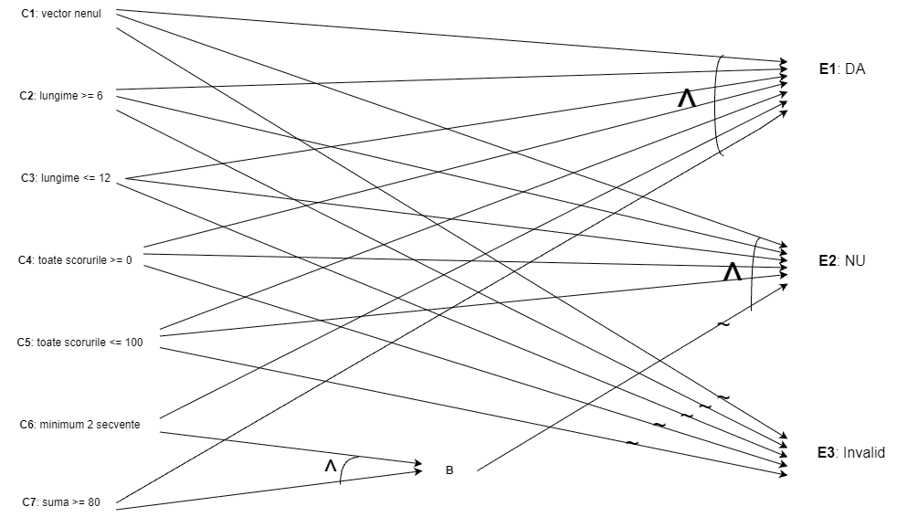

# Cerinta 1.c - Cause-Effect Graphing

## Graful cauza-efect

### 1. Identificarea cauzelor

Se definesc urmatoarele cauze:

- **C₁:** vectorul este nenul.
- **C₂:** lungimea vectorului este cel putin 6.
- **C₃:** lungimea vectorului este cel mult 12.
- **C₄:** toate elementele vectorului sunt mai mari sau egale cu 0.
- **C₅:** toate elementele vectorului sunt mai mici sau egale cu 100.
- **C₆:** exista cel putin doua secvente maximale strict crescatoare, fiecare cu lungime de minimum 3.
- **C₇:** suma ultimelor elemente ale tuturor secventelor relevante este cel putin 80.

Notand vectorul cu $v$, numarul secventelor relevante cu $k(v)$ si suma ultimelor elemente cu $S(v)$, cauzele pot fi exprimate astfel:

$$
C_1:\quad v \neq \mathrm{null}
$$

$$
C_2:\quad |v| \geq 6
$$

$$
C_3:\quad |v| \leq 12
$$

$$
C_4:\quad \forall i,\ v[i] \geq 0
$$

$$
C_5:\quad \forall i,\ v[i] \leq 100
$$

$$
C_6:\quad k(v) \geq 2
$$

$$
C_7:\quad S(v) \geq 80
$$

Cauzele C₂–C₅ se aplica vectorilor nenuli, iar C₆ si C₇ se evalueaza numai pentru vectorii valizi.

### 2. Identificarea efectelor

Se definesc urmatoarele efecte:

- **E₁:** metoda returneaza `"DA"`.
- **E₂:** metoda returneaza `"NU"`.
- **E₃:** metoda returneaza `"Vectorul nu este valid"`.

### 3. Relatiile dintre cauze si efecte

Conditia de validitate a vectorului este:

$$
V = C_1 \land C_2 \land C_3 \land C_4 \land C_5
$$

Conditia de acceptare pentru un vector valid este:

$$
B = C_6 \land C_7
$$

Efectele se exprima astfel:

$$
E_1 = V \land B
$$

$$
E_2 = V \land \neg B
$$

$$
E_3 = \neg V
$$

Prin inlocuirea expresiilor intermediare se obtin:

$$
E_1 = C_1 \land C_2 \land C_3 \land C_4 \land C_5 \land C_6 \land C_7
$$

$$
E_2 = C_1 \land C_2 \land C_3 \land C_4 \land C_5 \land (\neg C_6 \lor \neg C_7)
$$

$$
E_3 = \neg C_1 \lor \neg C_2 \lor \neg C_3 \lor \neg C_4 \lor \neg C_5
$$

Negarea uneia dintre cauzele C₁–C₅ determina invaliditatea vectorului.

Pentru un vector valid, efectul E₁ este produs numai daca ambele cauze C₆ si C₇ sunt adevarate. In caz contrar, se produce efectul E₂.

### 4. Constrangeri intre cauze

Cauzele C₂–C₅ necesita existenta vectorului. Daca C₁ este falsa, acestea nu sunt aplicabile.

C₂ si C₃ nu pot fi simultan false pentru un vector nenul:

$$
C_1 \Rightarrow (C_2 \lor C_3)
$$

Cauzele C₄ si C₅ pot fi simultan false, deoarece un vector poate contine atat un scor negativ, cat si un scor mai mare decat 100.

Cauzele C₆ si C₇ sunt aplicabile numai daca vectorul este valid:

$$
V = 1
$$

Pentru vectorii valizi, toate cele patru combinatii ale cauzelor C₆ si C₇ sunt realizabile.

### 5. Reprezentarea grafului cauza-efect

### 6. Tabelul de decizie

Pe baza grafului cauza-efect si a constrangerilor sunt obtinute urmatoarele reguli.

Notatii:

- **1** – cauza sau efect adevarat.
- **0** – cauza sau efect fals.
- **–** – cauza neaplicabila sau a carei valoare nu influenteaza efectul.

| Cauze / Efecte | R1 | R2 | R3 | R4 | R5 | R6 | R7 | R8 | R9 |
|---|---|---|---|---|---|---|---|---|---|
| C₁ | 0 | 1 | 1 | 1 | 1 | 1 | 1 | 1 | 1 |
| C₂ | – | 0 | 1 | 1 | 1 | 1 | 1 | 1 | 1 |
| C₃ | – | 1 | 0 | 1 | 1 | 1 | 1 | 1 | 1 |
| C₄ | – | – | – | 0 | 1 | 1 | 1 | 1 | 1 |
| C₅ | – | – | – | – | 0 | 1 | 1 | 1 | 1 |
| C₆ | – | – | – | – | – | 1 | 1 | 0 | 0 |
| C₇ | – | – | – | – | – | 1 | 0 | 1 | 0 |
| **E₁ – DA** | 0 | 0 | 0 | 0 | 0 | 1 | 0 | 0 | 0 |
| **E₂ – NU** | 0 | 0 | 0 | 0 | 0 | 0 | 1 | 1 | 1 |
| **E₃ – Invalid** | 1 | 1 | 1 | 1 | 1 | 0 | 0 | 0 | 0 |

Regulile corespund urmatoarelor situatii:

- **R1:** vectorul este `null` (C₁ = 0).
- **R2:** vectorul este nenul, dar lungimea sa este mai mica de 6 (C₂ = 0).
- **R3:** vectorul este nenul, dar lungimea sa este mai mare de 12 (C₃ = 0).
- **R4:** vectorul are lungime valida, dar contine cel putin un scor negativ (C₄ = 0).
- **R5:** vectorul are lungime valida, nu contine scoruri negative, dar contine cel putin un scor peste 100 (C₅ = 0).
- **R6:** vectorul este valid, iar C₆ = 1 si C₇ = 1.
- **R7:** vectorul este valid, iar C₆ = 1 si C₇ = 0.
- **R8:** vectorul este valid, iar C₆ = 0 si C₇ = 1.
- **R9:** vectorul este valid, iar C₆ = 0 si C₇ = 0.

Regulile R1–R5 acopera toate situatiile de invaliditate, iar R6–R9 acopera toate combinatiile realizabile ale cauzelor C₆ si C₇ pentru vectorii valizi.

### 7. Generarea datelor de test

Pentru fiecare regula din tabelul de decizie se selecteaza un caz de test reprezentativ.

| Test | Regula | Date de intrare | Rezultat asteptat |
|---|---|---|---|
| T1 | R1 | `null` | Vectorul nu este valid |
| T2 | R2 | `[1,2,3,4]` | Vectorul nu este valid |
| T3 | R3 | `[0,0,0,0,0,0,0,0,0,0,0,0,0]` | Vectorul nu este valid |
| T4 | R4 | `[5,10,20,0,-1,40]` | Vectorul nu este valid |
| T5 | R5 | `[0,20,40,0,20,101]` | Vectorul nu este valid |
| T6 | R6 | `[0,10,30,0,10,30,0,10,30]` | DA |
| T7 | R7 | `[0,10,35,0,10,44]` | NU |
| T8 | R8 | `[10,20,100,90,80,70]` | NU |
| T9 | R9 | `[40,40,40,40,40,40]` | NU |

### 8. Verificarea datelor de test

Pentru vectorii valizi, notam cu $k(v)$ numarul secventelor relevante si cu $S(v)$ suma ultimelor elemente ale acestora.

| Test | $k(v)$ | $S(v)$ | C₆ | C₇ | Efect |
|---|---|---|---|---|---|
| T6 | 3 | 90 | 1 | 1 | E₁ |
| T7 | 2 | 79 | 1 | 0 | E₂ |
| T8 | 1 | 100 | 0 | 1 | E₂ |
| T9 | 0 | 0 | 0 | 0 | E₂ |

**T1:** vectorul este `null`, deci C₁ este falsa si se produce efectul E₃.

**T2:** vectorul contine 4 elemente, deci C₂ este falsa si se produce efectul E₃.

**T3:** vectorul contine 13 elemente, deci C₃ este falsa si se produce efectul E₃.

**T4:** vectorul contine un scor negativ (-1), deci C₄ este falsa si se produce efectul E₃.

**T5:** vectorul contine un scor peste limita maxima (101), deci C₅ este falsa si se produce efectul E₃.

**T6:** exista trei secvente relevante de forma `[0,10,30]`. Suma ultimelor elemente este 90. Toate cele sapte cauze sunt adevarate, deci se produce efectul E₁.

**T7:** exista doua secvente relevante, `[0,10,35]` si `[0,10,44]`. Suma ultimelor elemente este 79. Cauza C₆ este adevarata, iar C₇ este falsa, deci se produce efectul E₂.

**T8:** exista o singura secventa relevanta, `[10,20,100]`, iar suma este 100. Cauza C₆ este falsa, iar C₇ este adevarata, deci se produce efectul E₂.

**T9:** vectorul contine doar valori egale. Nu exista secvente relevante, iar suma este 0. Cauzele C₆ si C₇ sunt false, deci se produce efectul E₂.
