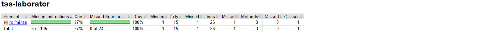
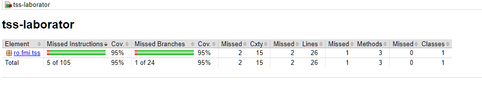
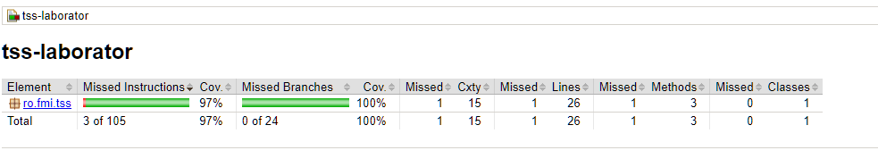
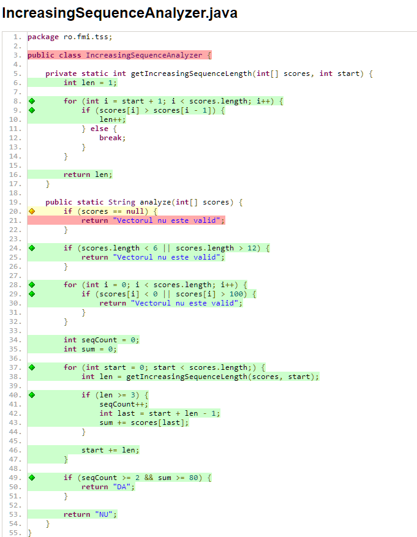
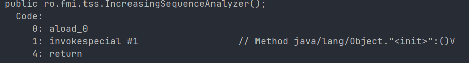

# Cerinta 2 - Code Coverage

## Analiza acoperirii codului

Pentru masurarea nivelului de acoperire a codului obtinut prin cele trei metode de testare functionala de la cerinta 1, a fost utilizat instrumentul **JaCoCo 0.8.16**, integrat in proiectul Maven.

Au fost analizate urmatoarele seturi de teste:

- **Equivalence Partitioning (EP)** - 9 teste.
- **Boundary Value Analysis (BVA)** - 21 de teste.
- **Cause-Effect Graphing (CEG)** - 9 teste.

Masuratorile au fost realizate separat pentru fiecare set, asupra clasei `IncreasingSequenceAnalyzer`, care contine metoda `analyze()` si functia auxiliara `getIncreasingSequenceLength()`.

### 1. Executarea testelor

JaCoCo a generat rapoarte HTML si CSV, din care au fost extrase valorile pentru acoperirea instructiunilor, ramurilor, liniilor si metodelor. Toate testele executate au trecut cu succes, fara erori sau esecuri.

Pentru fiecare set au fost utilizate urmatoarele comenzi:

- EP: `mvn clean verify "-Dtest=EquivalencePartitioningTest"`
- BVA: `mvn clean verify "-Dtest=BoundaryValueAnalysisTest"`
- CEG: `mvn clean verify "-Dtest=CauseEffectGraphingTest"`

Comanda `clean` elimina rezultatele executiei precedente,
iar parametrul `-Dtest` selecteaza doar setul analizat. Deci, masuratorile JaCoCo nu sunt cumulate.

### 2. Rezultatele obtinute

Rezultatele masuratorilor sunt prezentate in tabelul urmator:

| Indicator | EP | BVA | CEG |
|---|---|---|---|
| Numar teste | 9 | 21 | 9 |
| Instruction Coverage | 102/105 (97%) | 100/105 (95%) | 102/105 (97%) |
| Branch Coverage | 24/24 (100%) | 23/24 (95%) | 24/24 (100%) |
| Line Coverage | 25/26 | 24/26 | 25/26 |
| Method Coverage | 2/3 | 2/3 | 2/3 |
| Teste esuate | 0 | 0 | 0 |

Procentele din tabel sunt cele afisate in **rapoartele JaCoCo**.

**Instruction Coverage** = procentul instructiunilor bytecode executate de teste.\
**Branch Coverage** = procentul ramurilor parcurse in timpul executiei.\
**Line Coverage** = procentul liniilor executabile acoperite.\
**Method Coverage** = procentul metodelor executate, inclusiv constructorii.

### 3. Rapoartele JaCoCo

**Equivalence Partitioning:**



**Boundary Value Analysis:**



**Cause-Effect Graphing:**



Datele corespunzatoare fiecarui raport au fost salvate separat in fisierele `docs/coverage/EP.csv`, `docs/coverage/BVA.csv` si `docs/coverage/CEG.csv`.

### 4. Compararea rezultatelor

Seturile EP si CEG au obtinut rezultate identice, cu 97% Instruction Coverage si 100% Branch Coverage.

Desi au fost construite prin tehnici diferite, ambele seturi verifica principalele
categorii de invaliditate si combinatiile conditiilor finale ale programului.

Setul BVA, desi contine mai multe teste, a obtinut 95% Instruction Coverage si 95% Branch Coverage.

Diferenta provine din absenta unui caz de test cu referinta `null` in setul BVA.

La inceputul metodei `analyze()` exista conditia:

```java
if (scores == null) {
    return "Vectorul nu este valid";
}
```

Toate cele 21 de teste BVA transmit vectori nenuli. Prin urmare, ramura corespunzatoare conditiei `scores == null` adevarate nu este executata.

In schimb, seturile EP si CEG contin cate un test cu intrare `null`, acoperind si aceasta ramura.

Raportul detaliat JaCoCo pentru BVA evidentiaza conditia `scores == null` prin marcajul galben (acoperire partiala), iar instructiunea `return` corespunzatoare este marcata cu rosu (neexecutata).



Astfel, BRANCH COVERAGE-ul este:

$$
BC_{EP} = \frac{24}{24}\cdot100 = 100\%
$$

$$
BC_{BVA} = \frac{23}{24}\cdot100 \approx 95.83\%
$$

$$
BC_{CEG} = \frac{24}{24}\cdot100 = 100\%
$$

JaCoCo afiseaza valoarea de 95% pentru BVA.

Diferenta de o ramura explica si cele doua instructiuni suplimentare si linia suplimentara neacoperite de setul BVA.

### 5. Analiza metodelor neacoperite

Toate cele trei seturi au obtinut Method Coverage de 2/3.

Cele doua metode executate sunt:

- `analyze()`
- `getIncreasingSequenceLength()`

A treia metoda raportata de JaCoCo este constructorul implicit al clasei `IncreasingSequenceAnalyzer`, generat automat de compilatorul Java deoarece clasa nu declara explicit un constructor.

Bytecode-ul constructorului contine trei instructiuni: `aload_0`, `invokespecial` si `return`.



Testele utilizeaza exclusiv metodele statice, fara sa creeze instante ale clasei `IncreasingSequenceAnalyzer`.

Prin urmare, constructorul implicit nu este executat. Acesta explica cele 3 instructiuni si metoda neacoperite in rapoartele EP si CEG.

### 6. Concluzie

**EP si CEG au obtinut cea mai buna acoperire structurala**, cu 100% Branch Coverage si 97% Instruction Coverage.

**BVA a obtinut 95% Branch Coverage si 95% Instruction Coverage**, deoarece nu include un test pentru referinta nula.

Rezultatele arata ca un numar mai mare de teste nu garanteaza o acoperire structurala mai ridicata, aceasta depinzand de ramurile si instructiunile efectiv executate. Acoperirea obtinuta nu demonstreaza absenta tuturor defectelor, ci indica masura in care seturile de teste exercita structura programului.