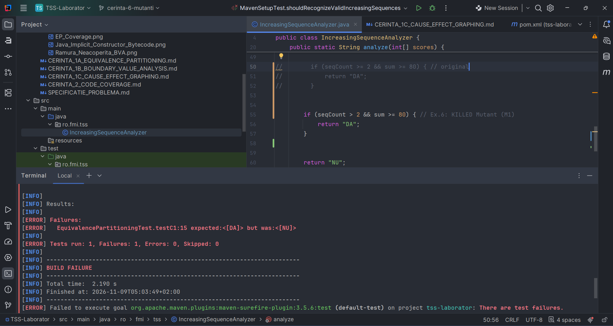
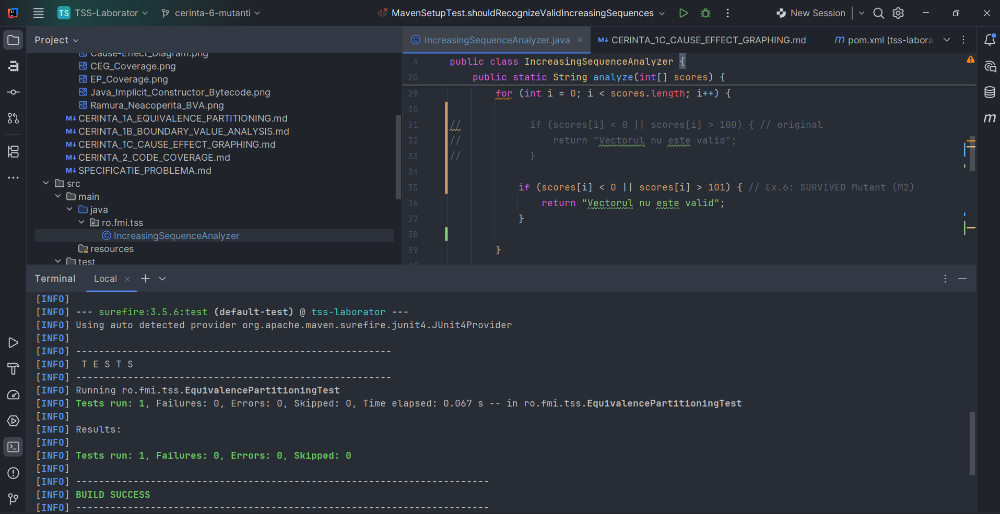
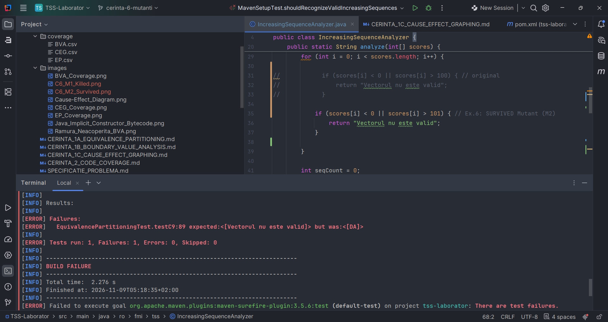

# Cerinta 6 - Mutanti neechivalenti

## 1. Cazul de test ales

Pentru aceasta cerinta a fost ales testul **T1 (`testC1`)** din setul Equivalence Partitioning, realizat la cerinta 1.

Intrare: `[10, 30, 50, 0, 20, 70]`

Rezultat asteptat: `"DA"`

Vectorul contine doua secvente strict crescatoare relevante, cu ultimele valori 50 si 70.

Astfel, `seqCount = 2`, iar `sum = 120`.

Testul trece pe implementarea originala.

## 2. Mutantul M1 - Killed

In implementarea originala, conditia finala este:

`if (seqCount >= 2 && sum >= 80)`

Pentru M1, operatorul `>=` a fost inlocuit cu `>`:

`if (seqCount > 2 && sum >= 80)`

Mutatia modifica o singura conditie relationala.

Pentru intrarea T1:

- Programul original returneaza `"DA"`.
- Mutantul M1 returneaza `"NU"`.

La executarea testului T1, JUnit raporteaza **1 test esuat** deoarece rezultatul obtinut difera de cel asteptat.

Prin urmare, mutantul M1 este **neechivalent si omorat (Killed)** de T1.

## 3. Mutantul M2 - Survived

Pornind din nou de la implementarea originala, a fost modificata conditia de validare a scorurilor:

Original: `scores[i] > 100`

Mutant M2: `scores[i] > 101`

Aceasta mutatie permite in mod eronat valoarea 101, care este interzisa conform specificatiei problemei.

La executarea aceluiasi test T1, toate scorurile sunt in intervalul valid si modificarea nu influenteaza rezultatul.

- Programul original returneaza `"DA"`.
- Mutantul M2 returneaza `"DA"`.

JUnit raporteaza **1 test trecut, fara erori**.

Prin urmare, mutantul M2 **supravietuieste (Survived)** testului T1.

### Demonstrarea neechivalentei mutantului M2

Pentru a demonstra ca M2 nu este echivalent cu programul original, a fost folosit suplimentar testul T9 (`testC9`) din Equivalence Partitioning.

Intrare: `[10, 30, 50, 0, 20, 101]`

- **Original:** `"Vectorul nu este valid"` deoarece scorul 101 depaseste limita 100.
- **M2:** `"DA"` deoarece noua conditie accepta valoarea 101.

Testul T9 esueaza pe M2, demonstrand ca mutantul produce un comportament diferit fata de programul original.

T9 a fost utilizat numai pentru demonstrarea neechivalentei. Testul de referinta pentru cei doi mutanti ramane T1.

## 4. Compararea rezultatelor

| Program | Rezultat pentru T1 | Verdict |
|---|---|---|
| Original | DA | Test trecut |
| M1 (`>= 2` devine `> 2`) | NU | Killed |
| M2 (`> 100` devine `> 101`) | DA | Survived |

Ambii mutanti sunt neechivalenti cu programul original deoarece exista intrari pentru care comportamentul lor difera de acesta.

## 5. Concluzie

A fost utilizat acelasi caz de test T1 pentru evaluarea a doi mutanti neechivalenti, construiti manual prin modificarea unui singur operator relational.

Testul T1 a omorat mutantul M1, dar nu a detectat mutantul M2. Neechivalenta lui M2 a fost demonstrata separat prin testul T9.

Rezultatele evidentiaza faptul ca un test poate detecta anumite defecte introduse in program, fara a le detecta pe toate.